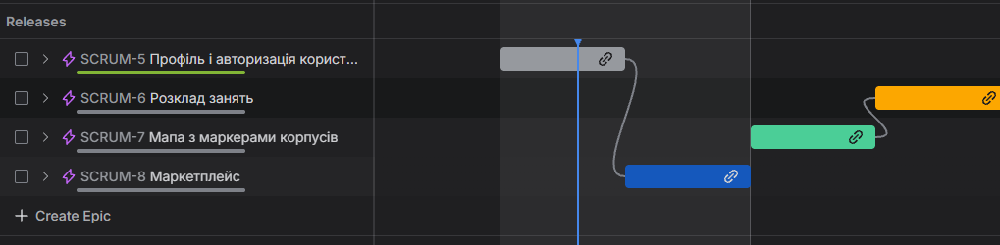
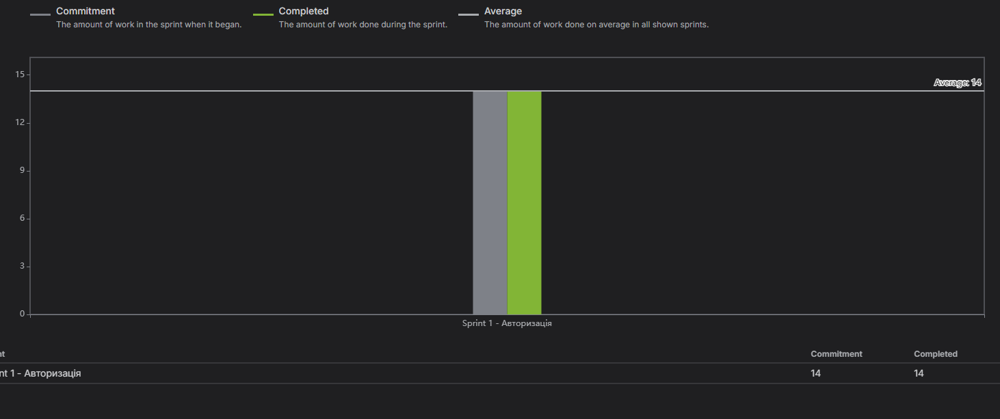
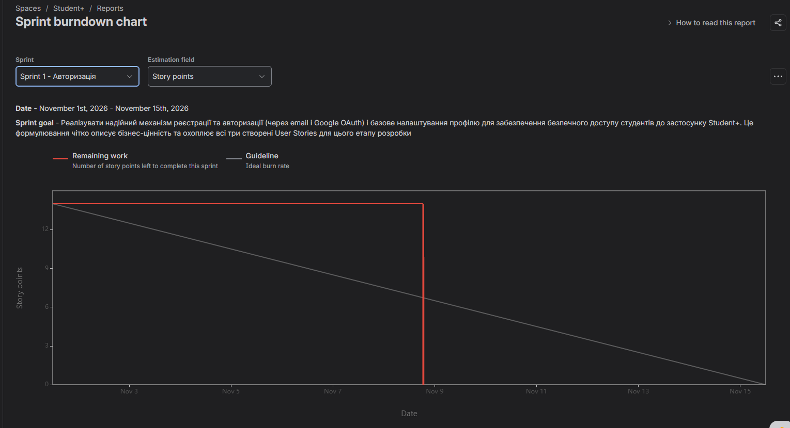
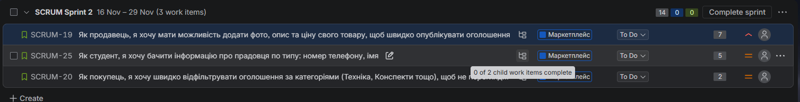
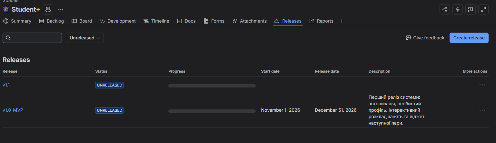

# План часу та вартості проекту Student+

**Команда:** Максим Кузнєцов, Дмитро Дужій, Ярослав Чен | **Jira:** [Student+ Board](https://pizza-iz-karmana-games.atlassian.net/jira/software/projects/SCRUM/boards/1) | **Дата:** 10 листопада 2026

---

## 1. Вихідні дані з Jira

| Параметр | Значення | Джерело в Jira |
|---|:---:|---|
| Загальний обсяг беклогу | 55 SP | Backlog → сума SP всіх 12 Stories |
| Velocity Sprint 1 | 14 SP | Reports → Velocity Chart (Sprint 1) |
| Кількість членів команди | 3 | Project settings → People / Access |
| Годин у спринті на особу | 40 год | 2 тижні × 5 днів × 4 год |
| Годин на 1 SP | 1.7 год | Σ Original Estimate (27 год) ÷ 16 SP (Крок 3) |
| Погодинна ставка | $15 | Умовна ставка |

> *Примітка:* Сума декомпонованих підзадач для історій SCRUM-19, SCRUM-20 та SCRUM-25 становить 27 годин на 16 SP ($\approx 1.69 \approx 1.7$ год/SP).

---

## 2. Критичний ланцюжок

Критичний ланцюжок сформовано наскрізною послідовністю взаємопов'язаних задач від авторизації до ключової функціональності маркетплейсу:

| # | Issue Key | Story | SP | Блокує |
|:-:|---|---|:---:|---|
| 1 | SCRUM-9 | Авторизація за email та паролем | 5 | SCRUM-11 |
| 2 | SCRUM-11 | Перегляд та редагування профілю користувача | 4 | SCRUM-19 |
| 3 | SCRUM-19 | Додавання фото, опису та ціни товару (створення оголошення) | 7 | SCRUM-25 |
| 4 | SCRUM-25 | Відображення контактної інформації продавця | 5 | Release v1.0-MVP |
| | **Разом** | | **21 SP** | |

| Epic / Story з резервом часу (Float) | Чому не на критичному шляху |
|---|---|
| **SCRUM-7 «Мапа з маркерами корпусів»** (SCRUM-15, SCRUM-16, SCRUM-17) | Має сумарну оцінку 10 SP і розробляється паралельно; не блокує запуск маркетплейсу та профіль користувача. |
| **SCRUM-6 «Розклад занять»** (SCRUM-12, SCRUM-13, SCRUM-14) | Залежить від мапи корпусів, проте сума SP обов'язкової частини (3 SP) значно менша за маркетплейс, а другорядні фічі винесені у v1.1. |
| **SCRUM-20 «Фільтрація оголошень» (2 SP) / SCRUM-18 «Стрічка товарів» (3 SP)** | Загальна тривалість їхнього підланцюжка (5 SP) менша за ланцюжок публікації та контактів (SCRUM-19 → SCRUM-25 = 12 SP). |

---

## 3. Прогноз тривалості

| Показник | Формула | Значення |
|---|---|:---:|
| Кількість спринтів | Обсяг беклогу ÷ Velocity | 55 ÷ 14 = 3.93 |
| Округлено | ↑ | 4 спринти |
| Дата початку Sprint 1 | з Jira (Sprint 1 - Авторизація) | 01.11.2026 |
| Дата релізу v1.0-MVP | Sprint 3 / Sprint 4 | 31.12.2026 |
| Чи вкладаємось у семестр? | | Так (до кінця грудня) |

> *Примітка:* Для обсягу версії `v1.0-MVP` (Must + Should = 42 SP) необхідно $42 \div 14 = 3$ спринти (реліз в середині грудня 2026). Повний беклог із версією `v1.1` (55 SP) завершується за 4 спринти (кінець грудня 2026).

---

## 4. Вартість команди

| Показник | Формула | Значення |
|---|---|---:|
| Team Cost per Sprint | 3 особи × 40 год × $15 | $1,800.00 |
| Вартість 1 SP | Team Cost ÷ Velocity ($1,800 ÷ 14) | $128.57 |
| Вартість 1 години | ставка | $15.00 |

---

## 5. Вартість по Epics

Розрахунок вартості епіків на основі вартості одного Story Point ($128.57 / SP):

| Epic | Issue Key | SP | Вартість | Fix Version | Пріоритет |
|---|---|:---:|---:|---|---|
| Профіль і авторизація користувача | SCRUM-5 | 14 | $1,800.00 | v1.0-MVP | Must / Should |
| Маркетплейс | SCRUM-8 | 17 | $2,185.71 | v1.0-MVP | Must / Should |
| Мапа з маркерами корпусів | SCRUM-7 | 10 | $1,285.71 | v1.0-MVP / v1.1 | Must / Could |
| Розклад занять | SCRUM-6 | 14 | $1,800.00 | v1.0-MVP / v1.1 | Must / Could |
| **Разом** | | **55** | **$7,071.42** | | |

---

## 6. Бюджет проекту

| Компонент | Розрахунок | Сума |
|---|---|---:|
| Оцінка беклогу | 55 SP × $128.57 | $7,071.42 |
| Contingency Reserve | 10% від оцінки беклогу | $707.14 |
| **Working Budget** | оцінка + contingency | **$7,778.56** |
| Management Reserve | 15% від Working Budget | $1,166.78 |
| **Total Budget** | Working + Management | **$8,945.34** |

---

## 7. Earned Value за Sprint 1

| Метрика | Розрахунок | Значення | Джерело в Jira |
|---|---|---:|---|
| PV | Заплановані SP × вартість SP (14 SP × $128.57) | $1,800.00 | Sprint Report → Committed |
| EV | Завершені SP × вартість SP (14 SP × $128.57) | $1,800.00 | Sprint Report → Completed |
| AC | 3 особи × 40 год × $15 (нормативні години команди) | $1,800.00 | Оцінка відпрацьованого часу |
| **CV** | EV − AC ($1,800 − $1,800) | $0.00 | В межах бюджету |
| **SV** | EV − PV ($1,800 − $1,800) | $0.00 | Точно за графіком |
| **CPI** | EV ÷ AC ($1,800 ÷ $1,800) | 1.00 | Ефективність витрат оптимальна |
| **SPI** | EV ÷ PV ($1,800 ÷ $1,800) | 1.00 | Темп робіт ідеальний |
| **EAC** | Total Budget ÷ CPI ($8,945.34 ÷ 1.00) | $8,945.34 | Прогноз відповідає початковому бюджету |

| Індекс | Значення | Стан | Інтерпретація |
|---|:---:|:---:|---|
| CPI | 1.00 | 🟢 | Витрати відповідають запланованому обсягу виконаної роботи |
| SPI | 1.00 | 🟢 | Робота виконана на 100% від плану спринту |

> 🟢 $\ge$ 1.0 | 🟡 0.9–1.0 | 🔴 < 0.9

---

## 8. Скріншоти

| # | Що на скріншоті | Файл |
|:-:|---|---|
| 1 | Roadmap з залежностями між Epics |  |
| 2 | Velocity Chart |  |
| 3 | Burndown Chart Sprint 1 |  |
| 4 | Story з Subtasks і Time Tracking (SCRUM-19 або SCRUM-20) |  |
| 5 | Releases (v1.0-MVP, v1.1) |  |

---

## 9. Рефлексія

| Питання | Відповідь команди |
|---|---|
| **Наскільки оцінка в годинах (Subtasks) збіглась зі Story Points? Який коефіцієнт вийшов?** | Оцінка в годинах показала стійку кореляцію з SP. Середній коефіцієнт склав **1.7 год на 1 SP** (27 год сумарно на 16 SP декомпонованих задач). При цьому типові технічні бекенд/фронтенд задачі тримаються в діапазоні 1.0–1.5 год/SP, тоді як задачі з дизайном та дослідженням досягають 2.0–3.0 год/SP. |
| **Чи змінилось розуміння термінів після розрахунку через Velocity? Встигаєте до кінця семестру?** | Так, розрахунок дав чітке бачення: за фіксованої швидкості 14 SP/спринт команді потрібно **3 спринти** для випуску повноцінного MVP (42 SP) і **4 спринти** для всього беклогу (55 SP). Стартувавши 01.11.2026, реліз v1.0 відбудеться в середині грудня, а повний скоуп — до 31.12.2026, тому команда повністю вкладається в рамки семестру. |
| **Що показав CPI/SPI за Sprint 1 і що команда зробить інакше у Sprint 2?** | Показники $CPI = 1.0$ та $SPI = 1.0$ демонструють успішне виконання плану Sprint 1 без затримок. Оскільки в Sprint 1 розробники не щоденно логували фактичний час у поле Time Tracking (через що AC розраховувався нормативно), головним уроком для Sprint 2 є обов'язкове щоденне внесення **Work log** у підзадачі для отримання детального графіка Burndown за годинами. |
| **Яка залежність виявилась найнебезпечнішою для проекту?** | Найбільш критичною є залежність між **SCRUM-5 «Профіль і авторизація»** та **SCRUM-8 «Маркетплейс»** (зокрема ланцюжок `SCRUM-19 → SCRUM-25`). Будь-яка затримка у створенні профілю блокує можливість виставляти товари та переглядати контакти продавців, що робить маркетплейс непрацездатним. |

> **Урок для Sprint 2:** У Sprint 1 фактичний час розраховувався як $3 \text{ особи} \times 40 \text{ год} \times \$15$, оскільки логи заповнювалися постфактум. У наступному спринті команда впроваджує щоденний облік через Work Log у кожній Subtask.
