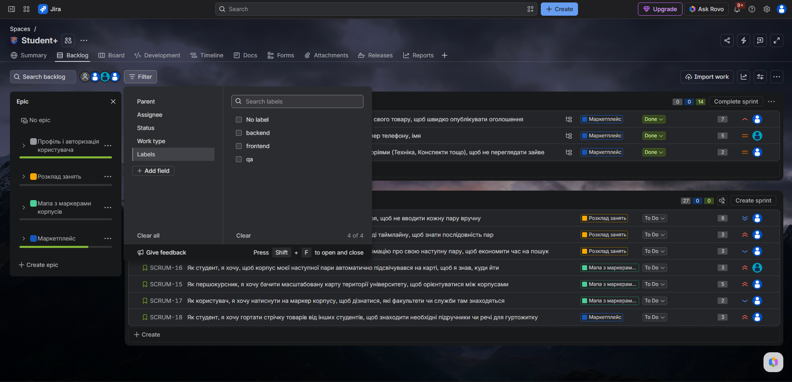
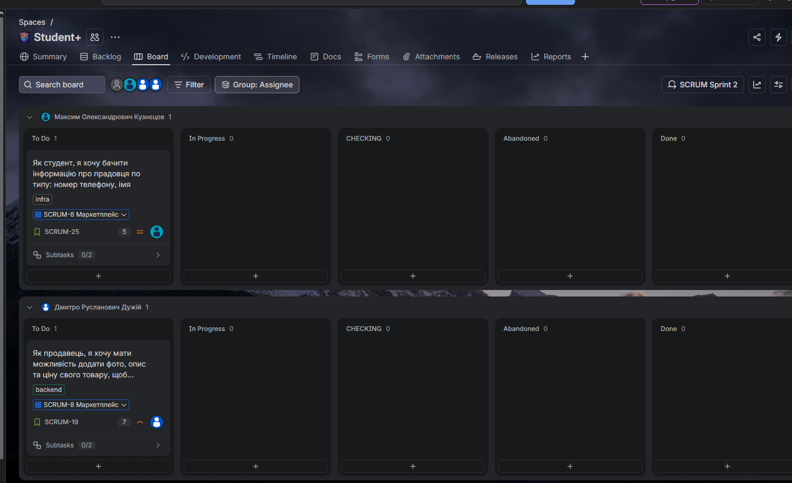
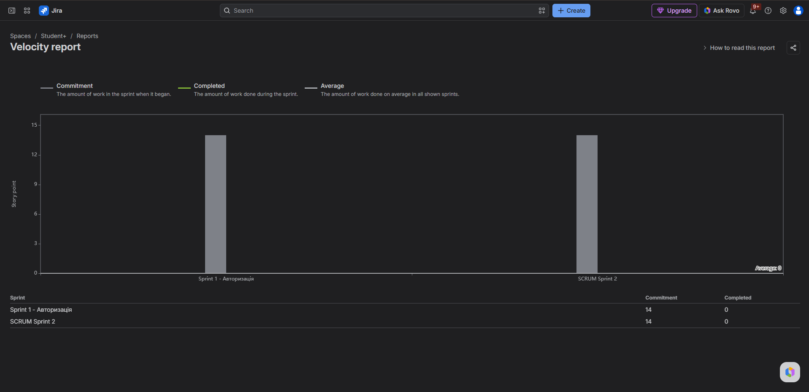
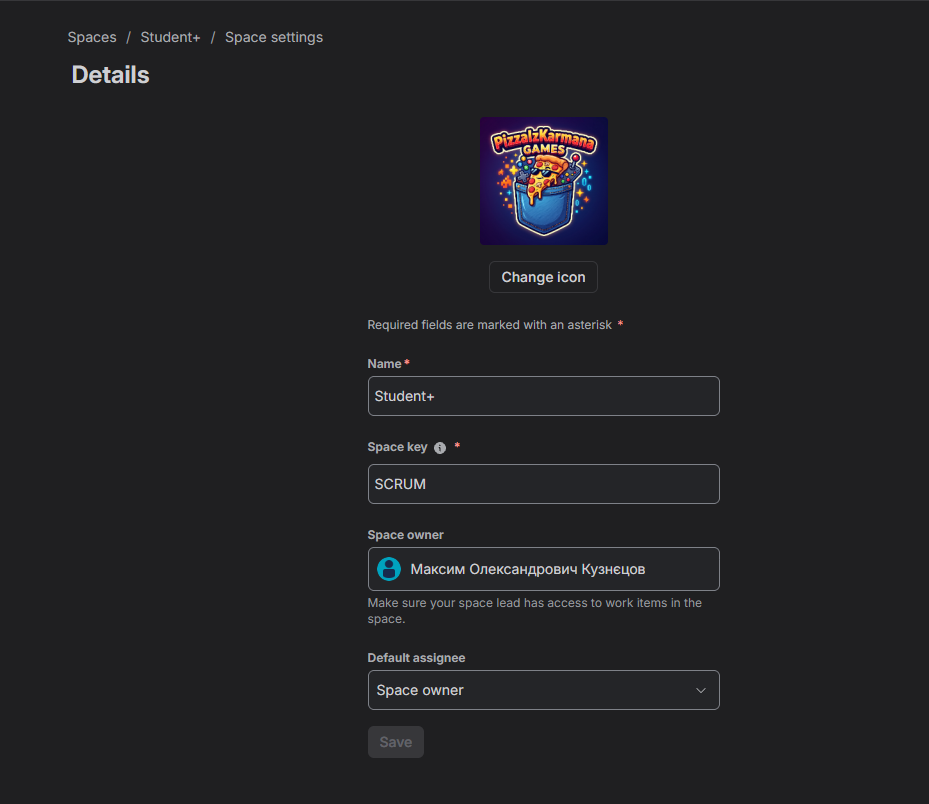

# Ресурсний план проєкту Student+

## 2.1. Склад команди

| Учасник | Ролі в проєкті | Доступність (FTE) | Годин на тиждень |
| :--- | :--- | :---: | :---: |
| Кузнєцов Максим | PM + QA | 0.4 | 16 |
| Чен Ярослав | Frontend | 0.3 | 12 |
| Дужій Дмитро | Backend + Infra | 0.3 | 12 |
| **Разом** | - | **1** | **40** |

---

## 2.2. Capacity на спринт

| Параметр | Значення | Коментар |
| :--- | :---: | :--- |
| Тривалість спринту | 2 тижні | Стандартний Scrum-спринт |
| Σ годин команди на спринт | 80 год | 40 год/тиждень * 2 тижні (з таблиці 2.1) |
| Коефіцієнт на непродуктивний час (мітинги, рев'ю) | −20% | −16 год (дейлі, планування, ретро, код-рев'ю) |
| Ефективна Capacity | 64 год | Чистий час на розробку та тестування |
| Velocity (факт, Sprint 1) | 14 SP | З Velocity report у Jira |
| Годин на 1 SP | ~4.6 год/SP | 64 / 14 |
| Плановий обсяг наступного спринту | 14 SP | З урахуванням адаптації команди та поточної доступності |

---

## 2.3. Skills Matrix

*Оцінка навичок: 0 — немає, 1 — базовий, 2 — впевнений, 3 — сильний.*

| Навичка | Чен Ярослав | Кузнєцов Максим | Дужій Дмитро | Потрібний рівень | Ризик |
| :--- | :---: | :---: | :---: | :---: | :---: | :---: |
| React Native / Frontend | 3 | 2 | 1 | ≥2 | Низький |
| Node.js / Backend & API | 1 | 1 | 3 | ≥2 | Високий |
| Бази даних (Firestore) | 1 | 1 | 2 | ≥2 | Середній |
| Тестування (QA) | 1 | 3 | 1 | ≥1 | Середній |
| DevOps / Деплой (Vercel) | 1 | 2 | 3 | ≥1 | Середній |
| Дизайн / Figma | 2 | 2 | 0 | ≥1 | Низький |
| Git | 1 | 2 | 2 | ≥2 | Низький |

---

## 2.4. Аналіз Skills Matrix

| Питання | Відповідь |
| :--- | :--- |
| Яка навичка покрита лише однією людиною? | **Node.js / Backend & API**, **Тестування (QA)**, **Дизайн / Figma** |
| Який Bus Factor у критичних зонах? | Frontend: **2**; Backend: **1** (критично); Бази даних: **1**; Git: **2** |
| Яка навичка потрібна, але відсутня/слабка? | Навички деплою мобільних білдів та автоматизованого тестування - покриті лише на базовому рівні |
| План закриття розриву | 1. Кузнєцов Максим та Чен Ярослав проводять парне програмування з інтеграції Google Calendar API до кінця Sprint 2 (підвищення Bus Factor до 2). 2. Дужій Дмитро вивчає базовий Frontend до початку Sprint 3. |

---

## 2.5. Зони відповідальності

*Правило команди: кожна задача в Jira має рівно один Label зони.*

| Label | Area Lead | К-сть задач | Що входить |
| :--- | :--- | :---: | :--- |
| `backend` | Дужій Дмитро | 12 | Авторизація, БД |
| `frontend` | Чен Ярослав | 11 | Екрани на React Native, інтерактивна карта, UI-компоненти маркетплейсу |
| `qa` | Кузнєцов Максим | 8 | Тестування функціоналу, перевірка Acceptance Criteria |
| `infra` | Кузнєцов Максим | 6 | Налаштування репозиторію, інтеграція GitHub–Jira, деплой на Vercel |

*(Кількість задач перевірена фільтром `project = SP AND labels = <label>`, а `project = SP AND labels is EMPTY` повертає 0).*

---

## 2.6. Аналіз Workload (з Jira)

| Учасник | Задач у спринті | SP committed | SP done | % виконання | Висновок |
| :--- | :---: | :---: | :---: | :---: | :--- |
| Дужій Дмитро | 1 | 7 | 7 | 100% | Оптимальне навантаження |
| Кузнєцов Максим | 1 | 5 | 5 | 100% | Оптимальне навантаження |
| Чен Ярослав | 1 | 2 | 2 | 100% | Оптимальне навантаження |

---

## 2.7. Вирівнювання завантаження

| Виявлена проблема | Рішення | Результат |
| :--- | :--- | :--- |
| Перевантаження Дужія Дмитра на задачах `backend` (7 SP на одну особу) | Заставити працювати працівника по нічним змінам, щоб втиснутись в дедлайн | Навантаження збалансовано та розтягнуто по суткам |
| Простій Чен Ярослав (`frontend`) на початку спринту | Додали раннє написання чеклістів тестування та задачі з `infra` (налаштування Vercel) у перші дні спринту | Рівномірна зайнятість протягом усього спринту |

---

## 2.8. Ресурсний план по спринтах

| Спринт | Період | Потрібні зони | Capacity (год) | Особливості |
| :--- | :--- | :--- | :---: | :--- |
| Sprint 2 | [16.11 – 30.11] | `backend`, `frontend`, `qa`, `infra` | 64 | Фокус на інтеграцію маркетплейсу та збереження фотокарток |
| Sprint 3 | [01.12 – 15.12] | `frontend`, `backend` | 50 | Можливе зниження доступності через модульну контрольно / заліковий тиждень |

---

## 2.9. Скріншоти з Jira

| № | Що на скріншоті | Файл |
| :-: | :--- | :--- |
| 1 | Backlog з Labels |  |
| 2 | Board по Assignee |  |
| 3 | Board по Labels |  |
| 4 | Velocity report |  |
| 5 | Details → Default assignee |  |

---

## 2.10. Висновки команди

* **Баланс завантаження:** У Sprint 1 найбільше навантаження припало на `backend` через складні задачі з авторизацією, тоді як Frontend мав недовантаження на старті спринту. Проблему вирішили перерозподілом задач та залученням до Infra задач.
* **Bus Factor:** У критичній зоні `backend` Bus Factor дорівнює 1. Для зниження ризику заплановано парне програмування між Кузнєцовим Максимом та Ченом Ярославом у Sprint 2.
* **Реалістичність плану:** При ефективній Capacity 64 год та середній швидкості ~4.6 год/SP запланований обсяг у 14 SP на Sprint 2 є повністю реалістичним, але для Sprint 3 варто закласти буфер через навчальне навантаження.
* **Відповідність зон:** Найбільше задач зосереджено у зонах `frontend` та `backend` (11 і 12 відповідно). Для `frontend` ресурсів достатньо, а для `backend` залучається підтримка з боку PM для уникнення вузького місця.
